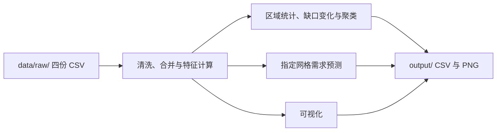

# 🚲 城市共享出行供需分析

<p>
  
  
  
</p>

> 将骑行订单、网格、天气和调度记录整理为网格—日期级数据，一次运行生成供需统计、需求预测、聚类汇总和可视化图表。

## 📖 项目简介

共享出行订单记录了车辆从哪里出发、在哪里结束。将订单和调度记录汇总到同一网格和日期，可以查看不同区域的订单需求，以及骑行和调度共同作用下的车辆流动差额。

项目基于《城市共享出行供需平衡与调度热区分析》模拟题，将原 Notebook 的数据处理、分析、预测和绘图拆为可独立维护的 Python 模块。

## ✨ 功能特性

| 能力 | 说明 |
| --- | --- |
| 数据清洗 | 统计缺失值，按日期对天气数据插值，填补缺失的调度量，筛除不符合时长和距离规则的订单 |
| 网格日汇总 | 按网格和日期统计出发量、到达量、平均骑行距离、平均骑行时长和高峰订单占比 |
| 供需指标 | 计算净调度量、供需缺口、需求变化和网格内标准化特征 |
| 需求预测 | 对三个指定网格分别训练线性回归模型，输出留出期预测、实际值和 RMSE |
| 图表与聚类 | 绘制全市趋势、网格气泡图和指定网格的双轴图，汇总四个 K-means 簇 |

## 🗄️ 数据说明

仓库的 `data/raw/` 包含四份模拟题配套 CSV。

| 文件 | 粒度 | 关键字段 |
| --- | --- | --- |
| `trips.csv` | 单次骑行 | `trip_id`、`start_time`、`end_time`、`start_grid`、`end_grid`、`distance_km` |
| `grids.csv` | 单个网格 | `grid_id`、`lng`、`lat`、`district` |
| `weather.csv` | 单日 | `date`、`temp_c`、`rain_mm`、`wind_ms` |
| `ops.csv` | 网格—日期 | `grid_id`、`date`、`dispatch_in`、`dispatch_out` |

**供需缺口** = 出发订单量 − 到达订单量 − 净调度量，其中净调度量 = 调入量 − 调出量。该指标描述网格当日的车辆流动差额。

## 🔄 处理流程



## 🚀 快速开始

在项目根目录运行以下命令。已在 Windows 和 Python 3.13 环境验证，依赖由 `requirements.txt` 声明，包括 pandas、NumPy、Matplotlib 和 scikit-learn。

```powershell
python -m venv .venv
.\.venv\Scripts\python.exe -m pip install -r requirements.txt
.\.venv\Scripts\python.exe main.py
```

程序运行成功后会打印 `Results saved to ...`，并在项目根目录生成 `output/`。

## 📁 目录结构

```text
traffic/
├── data/raw/
│   ├── trips.csv
│   ├── grids.csv
│   ├── weather.csv
│   └── ops.csv
├── src/bike_sharing_demand_analysis/
│   ├── __init__.py
│   ├── pipeline.py
│   ├── preprocessing.py
│   ├── analysis.py
│   ├── forecasting.py
│   └── visualization.py
├── notebooks/blue3.ipynb  # 本地留档，Git 忽略
├── tests/test_preprocessing.py
├── output/  # 运行后生成
├── main.py
├── requirements.txt
├── .gitignore
└── README.md
```

## 📤 输出结果

运行会在 `output/` 生成 13 份 CSV 和 3 张 PNG。输出目录已加入 `.gitignore`。

| 文件 | 内容 |
| --- | --- |
| `001cleaned_data.csv` | 原始订单、天气和调度表的缺失值统计 |
| `002cleaned_data.csv` | 清洗后的骑行明细，含日期、小时和骑行时长 |
| `003merged_data.csv`、`004processed_data.csv` | 网格日合并数据及其标准化特征 |
| `005descriptive_stats.csv` | 按行政区汇总的需求、缺口和高峰占比统计 |
| `006district_trend.csv`、`007correlation.csv` | 当前版本的趋势中间结果和降雨相关系数，指标口径见下文 |
| `008forecast_results.csv` | 网格 `G0001`、`G0002`、`G0003` 的实际需求、预测需求和 RMSE |
| `009global_trends.csv`、`global_trends.png` | 全市每日总需求与平均缺口趋势 |
| `010map_data.csv`、`map_2024.png` | 2024 年 3 月 31 日各网格需求和缺口气泡图 |
| `011combo_data.csv`、`combo_chart.png` | 三个指定网格的需求和缺口双轴图 |
| `012top_reduction.csv` | 按 2024 年 3 月 31 日与 1 月 1 日的缺口差值升序取前五条 |
| `013cluster_summary.csv` | 各簇的平均需求、平均缺口、平均高峰占比和去重网格数 |

## 🧩 核心模块

| 模块 | 职责 |
| --- | --- |
| `main.py`、`pipeline.py` | 提供运行入口，创建输出目录并按顺序调用各模块 |
| `preprocessing.py` | 读取原始数据、处理缺失和异常、汇总网格日记录并计算特征 |
| `analysis.py` | 生成区域统计、趋势与相关表、缺口变化排名和聚类汇总 |
| `forecasting.py` | 以日期序号为特征，在 2024 年 1 月 1 日至 3 月 24 日的数据上训练，并用 3 月 25 日至 31 日的数据评估 |
| `visualization.py` | 导出三类图表及对应数据 |

## 🔍 当前分析口径

- `006district_trend.csv` 的 `slope` 列目前存的是行政区内相邻记录的订单量百分比变化，行政区日需求的线性回归斜率待实现。
- `007correlation.csv` 当前计算降雨量与订单量的 Pearson 相关系数，需求日增长率的相关分析待实现。
- K-means 的样本单位为网格—日期，同一网格可在不同日期进入不同簇，簇内网格数按 `grid_id` 去重。

## 回归测试

在项目根目录运行以下命令，验证天气和调度数据能按订单日期正确关联。

```powershell
python -m unittest discover -s tests
```
