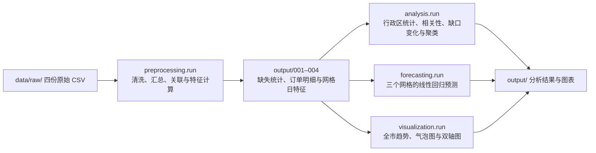

# 🚲 城市共享出行供需分析

<p>
  
  
  
  
  
</p>

> 将骑行订单、城市网格、天气和调度记录整理为网格日数据，一条命令完成清洗、供需指标计算、需求预测、聚类分析与图表导出。

---

## 📖 项目简介

共享出行分析需要把车辆的出发、到达和人工调度放到同一时间与空间尺度下观察。本项目以“网格 × 日期”为分析单位，关联四类数据，分析各行政区的订单分布、网格车辆流动差额及其随时间的变化。

项目使用原 Notebook 配套的模拟题数据，将处理过程拆分为预处理、统计分析、预测和可视化模块。运行后生成结构化 CSV、三个指定网格的需求预测结果、四类网格日聚类汇总，以及三张分析图表。

## ✨ 功能特性

| 能力 | 说明 |
| --- | --- |
| 🗂️ 数据接入 | 从项目内的 `data/raw/` 读取订单、网格、天气和调度四份 CSV |
| 🧹 数据清洗 | 统计缺失值，插值填补天气数据，处理调度空值，筛除时长或距离超出规则的订单 |
| 🔗 多表关联 | 统一日期键，按网格和日期汇总订单，再关联位置、行政区、天气及调度信息 |
| 📊 供需指标 | 计算出发量、到达量、净调度、供需缺口、需求变化率和网格内 Z-score |
| 📈 统计分析 | 汇总行政区描述统计、降雨相关性，以及指定首尾日期的缺口变化排名 |
| 🤖 需求预测 | 以日期序号为特征，对三个指定网格训练线性回归模型并在留出期计算 RMSE |
| 🧩 聚类分析 | 基于三个标准化特征，对网格日记录进行四簇 K-means 聚类 |
| 🗺️ 可视化 | 输出全市趋势图、网格需求与缺口气泡图、指定网格双轴折线图 |
| 🧪 回归测试 | 用固定样本验证订单日期与天气、调度数据的关联及缺口计算 |

## 🗄️ 数据说明

原始数据位于 `data/raw/`。数据覆盖 **2024 年 1 月 1 日至 3 月 31 日**，共 91 天，包含 500 个网格和 8 个行政区。

| 文件 | 原始记录数 | 粒度 | 关键字段 |
| --- | ---: | --- | --- |
| `trips.csv` | 150,000 | 单次骑行 | `trip_id`、`start_time`、`end_time`、`start_grid`、`end_grid`、`distance_km` |
| `grids.csv` | 500 | 网格 | `grid_id`、`lng`、`lat`、`district` |
| `weather.csv` | 91 | 日期 | `date`、`temp_c`、`rain_mm`、`wind_ms` |
| `ops.csv` | 45,500 | 网格 × 日期 | `grid_id`、`date`、`dispatch_in`、`dispatch_out` |

订单分别按起点和终点汇总，再按 `grid_id + date` 外连接。合并表覆盖清洗后订单中有出发或到达记录的网格日，随后关联网格信息、当日天气与人工调度数据。

## 🔄 处理流程



`main.py` 确定项目根目录，`pipeline.run` 依次调用各阶段模块。完整流程生成 **13 份 CSV 和 3 张 PNG**。

## 🚀 快速开始

### 环境要求

已在 **Windows、Python 3.13.5** 环境完成运行验证。依赖由 `requirements.txt` 声明，包括 pandas、NumPy、Matplotlib 和 scikit-learn。

### 下载与安装

```powershell
git clone https://github.com/Qian-Bo-Han/traffic.git
cd traffic

python -m venv .venv
.\.venv\Scripts\python.exe -m pip install -r requirements.txt
```

### 运行

```powershell
.\.venv\Scripts\python.exe main.py
```

成功后会显示类似信息，结果写入项目根目录下的 `output/`。

```text
Results saved to ...\traffic\output
```

输入与输出路径根据 `main.py` 所在目录确定，图表由程序直接保存为 PNG。

## 📁 目录结构

```text
traffic/
├── data/
│   └── raw/
│       ├── trips.csv                    # 原始骑行订单
│       ├── grids.csv                    # 网格位置与行政区
│       ├── weather.csv                  # 每日天气
│       └── ops.csv                      # 网格每日调度记录
├── src/
│   └── bike_sharing_demand_analysis/
│       ├── __init__.py
│       ├── preprocessing.py             # 数据清洗、多表关联与特征计算
│       ├── analysis.py                  # 统计、相关性、缺口变化与聚类
│       ├── forecasting.py               # 线性回归预测与误差评估
│       ├── visualization.py             # 图表及对应数据导出
│       └── pipeline.py                  # 全流程编排
├── tests/
│   └── test_preprocessing.py            # 日期关联回归测试
├── output/                              # 运行时生成，已加入 Git 忽略规则
├── main.py                              # 项目运行入口
├── requirements.txt                     # 运行依赖
├── .gitignore
└── README.md
```

原始 Notebook 在本地 `notebooks/blue3.ipynb` 留档，已加入 Git 忽略规则。仓库内的四份原始 CSV 支持完整流程复现。

## 📤 输出结果

以下结果规模使用仓库附带数据核对，所有文件生成在 `output/`。

| 文件 | 内容 | 主要字段 |
| --- | --- | --- |
| `001cleaned_data.csv` | 订单、天气和调度表的字段缺失统计 | `columns`、`missing_columns` |
| `002cleaned_data.csv` | 147,367 条清洗后的骑行记录 | 订单与起终点信息、`date`、`hour`、`duration_min` |
| `003merged_data.csv` | 45,352 条网格日记录及供需指标 | `grid_id`、`date`、`demand_start`、`demand_end`、`gap_index`、天气与调度字段 |
| `004processed_data.csv` | 网格日数据及三个标准化特征 | `demand_start_zscore`、`demand_growth_rate_zscore`、`gap_index_zscore` |
| `005descriptive_stats.csv` | 8 个行政区的描述统计 | 需求、缺口、高峰占比的均值、标准差、最小值与最大值 |
| `006district_trend.csv` | 行政区分组内相邻记录的需求变化 | `district`、`slope` |
| `007correlation.csv` | 各行政区降雨量与订单出发量的相关系数 | `district`、`correlation` |
| `008forecast_results.csv` | 三个网格共 21 条留出期预测记录 | `grid_id`、`date`、`actual`、`forecast`、`rmse` |
| `009global_trends.csv` | 91 天的全市需求与平均缺口 | `date`、`total_demand_start`、`avg_gap_index` |
| `010map_data.csv` | 2024 年 3 月 31 日的 499 个有订单活动网格 | 位置、行政区、需求、缺口、`bubble_size` |
| `011combo_data.csv` | 三个指定网格共 273 条日记录 | `grid_id`、`date`、`demand_start`、`gap_index`、`district` |
| `012top_reduction.csv` | 按首尾日期缺口变化升序排列的前 5 个网格 | `grid_id`、`change`、`net_dispatch_change` |
| `013cluster_summary.csv` | 四个簇的统计汇总 | `cluster_label`、平均需求、平均缺口、平均高峰占比、`grid_count` |

| 图表 | 展示内容 |
| --- | --- |
| `global_trends.png` | 每日全市出发订单总量与平均缺口指标 |
| `map_2024.png` | 指定日期的网格分布，气泡大小表示需求量，颜色表示缺口指标 |
| `combo_chart.png` | `G0001`、`G0002`、`G0003` 的每日需求与缺口双轴折线图 |

### 需求预测结果

三个网格分别使用 **2024 年 1 月 1 日至 3 月 24 日**的数据训练，使用 **3 月 25 日至 31 日**的数据评估。自变量为按日期排序后的记录序号，目标变量为当日出发订单量。

下表的 RMSE 由导出的实际值和预测值重新计算，保留四位小数。

| 网格 | 留出期记录数 | RMSE（单） |
| --- | ---: | ---: |
| `G0001` | 7 | 0.5735 |
| `G0002` | 7 | 1.3066 |
| `G0003` | 7 | 1.2730 |

这些数值对应上述三个网格的七天留出期，用于展示日期序号线性回归基线的误差。

## 🧩 核心模块

| 模块 | 入口 | 职责 |
| --- | --- | --- |
| `main.py` | `python main.py` | 解析项目根目录并启动流程 |
| `pipeline.py` | `run(project_root)` | 创建输出目录，依次执行预处理、分析、预测与绘图 |
| `preprocessing.py` | `run(data_folder)` | 读取原始数据，完成清洗、网格日汇总、多表关联与标准化特征计算 |
| `analysis.py` | `run(data_folder)` | 输出行政区统计、变化率、相关系数、缺口变化排名和 K-means 汇总 |
| `forecasting.py` | `run(data_folder)` | 训练线性回归模型，导出留出期预测与 RMSE |
| `visualization.py` | `run(data_folder)` | 生成三类图表并导出对应绘图数据 |

各阶段 `run(data_folder)` 的参数指向输出目录，中间结果通过 CSV 衔接。

## 🔍 数据处理规则与指标口径

### 清洗与关联规则

| 环节 | 当前规则 |
| --- | --- |
| 天气缺失 | 按日期排序，对 `temp_c`、`rain_mm`、`wind_ms` 进行线性插值，并处理两端空值 |
| 调度缺失 | 将 `dispatch_in`、`dispatch_out` 的空值填为 0，转换为整数 |
| 订单完整性 | 删除结束时间或骑行距离缺失的订单 |
| 骑行时长 | 保留 `0 < duration_min ≤ 180` 的订单，单位为分钟 |
| 骑行距离 | 保留 `0 < distance_km ≤ 30` 的订单，单位为千米 |
| 日期关联 | 将订单日期转换为 `YYYY-MM-DD` 字符串，与天气和调度表的日期键对齐 |
| 高峰标记 | 开始时间的小时满足 `7 ≤ hour ≤ 9` 或 `17 ≤ hour ≤ 19` 时标记为高峰 |
| 合并后填补 | 出发量、到达量、高峰占比、调度量及平均骑行指标的合并空值按现有规则填为 0 |

### 供需指标

```text
net_dispatch = dispatch_in - dispatch_out
gap_index = demand_start - (demand_end + net_dispatch)
```

`gap_index` 描述网格当日的车辆流动差额。正值表示出发量高于到达量与净调入量之和，负值表示后者较高。

`demand_growth_rate` 按网格和日期排序后计算相邻记录的出发量变化率，首条记录保留空值，无穷值替换为 0。三个 Z-score 特征分别使用各网格内的均值与样本标准差计算。

### 分析口径

| 项目 | 当前实现 |
| --- | --- |
| `006district_trend.csv` 的 `slope` | 在行政区分组内按现有记录顺序计算出发量的百分比变化，包含跨网格相邻记录。行政区日汇总后的回归斜率有待补充 |
| `007correlation.csv` | 按行政区计算降雨量与出发订单量的 Pearson 相关系数。需求日增长率的相关分析有待补充 |
| 缺口变化排名 | 比较 2024 年 3 月 31 日与 1 月 1 日的 `gap_index` 差值，按差值升序取前五条 |
| K-means 样本 | 每条记录代表一个网格在一天的状态。采用三个 Z-score 特征，剔除特征空值后分为 4 簇，`random_state=42` |
| 簇内网格数 | `grid_count` 按簇对 `grid_id` 去重。同一网格在不同日期可以进入不同簇，各簇计数存在重叠 |

## 🛠️ 开发与验证

在项目根目录运行日期关联回归测试。

```powershell
.\.venv\Scripts\python.exe -m unittest discover -s tests -v
```

测试使用固定订单、天气和调度样本，检查关联后的日期、天气数值、调入调出量及供需缺口，覆盖日期类型不一致造成关联丢失的场景。
